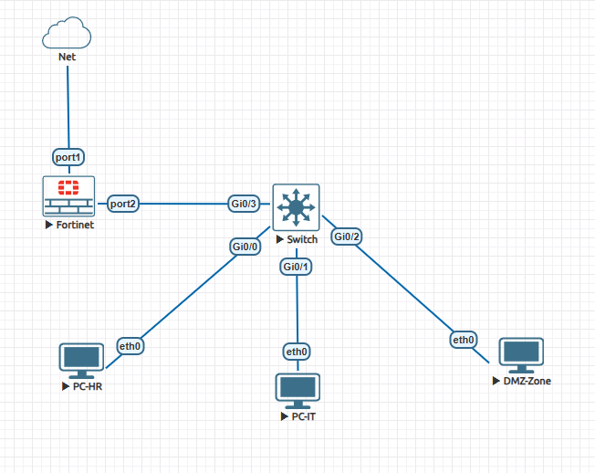
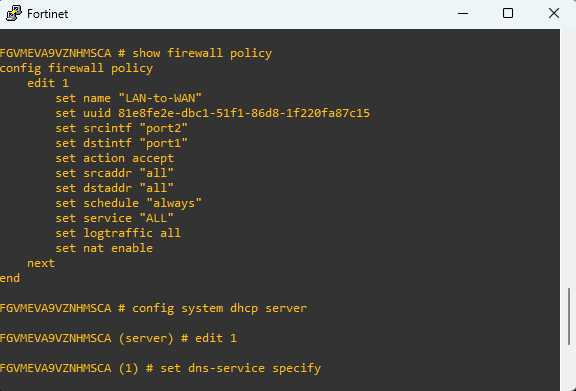
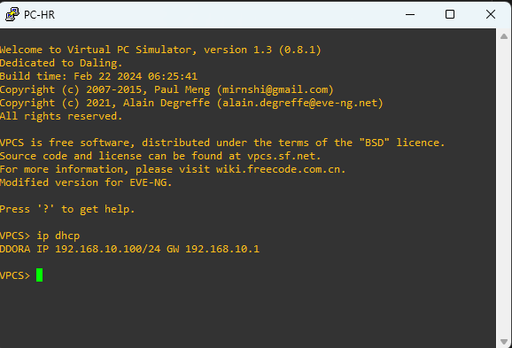
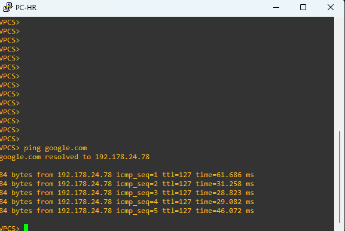
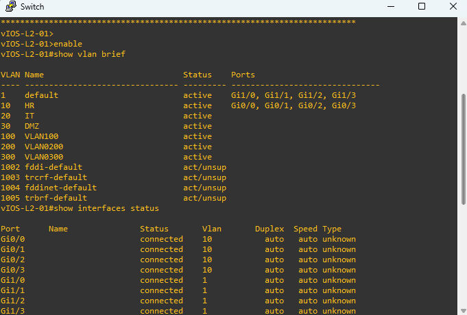

# FortiGate Network Security Lab

A hands-on network security lab built using **FortiGate 7.2.4, Cisco IOSvL2 and EVE-NG**.

## 1. Project Overview

This project demonstrates the deployment and configuration of a FortiGate firewall in a virtual enterprise network environment.

The lab covers firewall policies, outbound NAT, DHCP, DNS, WAN/LAN connectivity and traffic logging.

## 2. Lab Topology

**Components:**
- FortiGate 7.2.4 Firewall
- Cisco IOSvL2 Virtual Switch
- PC-HR
- PC-IT
- DMZ-Zone
- EVE-NG

## 3. IP Addressing

| Component | Configuration |
|---|---|
| WAN | DHCP |
| LAN Gateway | 192.168.10.1/24 |
| DHCP Pool | 192.168.10.100–192.168.10.200 |
| LAN Interface | FortiGate port2 |

## 4. Implemented Features

- FortiGate WAN/LAN interface configuration
- DHCP server and DNS configuration
- Outbound NAT
- LAN-to-WAN firewall policy
- Cisco IOSvL2 switch port configuration
- Firewall traffic logging
- Network connectivity testing

## 5. Configuration Evidence

### FortiGate Firewall Policy

### DHCP Configuration and Address Assignment

### Internet Connectivity Test

### Cisco Switch VLAN Configuration

## 6. Verification Results

- DHCP address assignment: Successful
- Default gateway connectivity: Successful
- Internet connectivity to 8.8.8.8: Successful
- DNS resolution for google.com: Successful

## 7. Network Design Note

All three endpoints currently operate in the same LAN subnet and VLAN 10. Separate HR, IT and DMZ security zones and inter-VLAN isolation are not implemented in this version.

## 8. Technologies

FortiGate 7.2.4 | EVE-NG | Cisco IOSvL2 | VPCS | DHCP | DNS | NAT | Firewall Policies | ICMP

## Author

**Burak Kılıç**

Network & Security Engineering Portfolio Project
