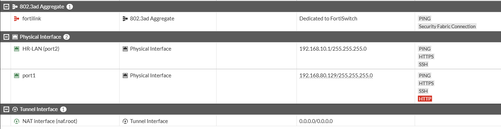
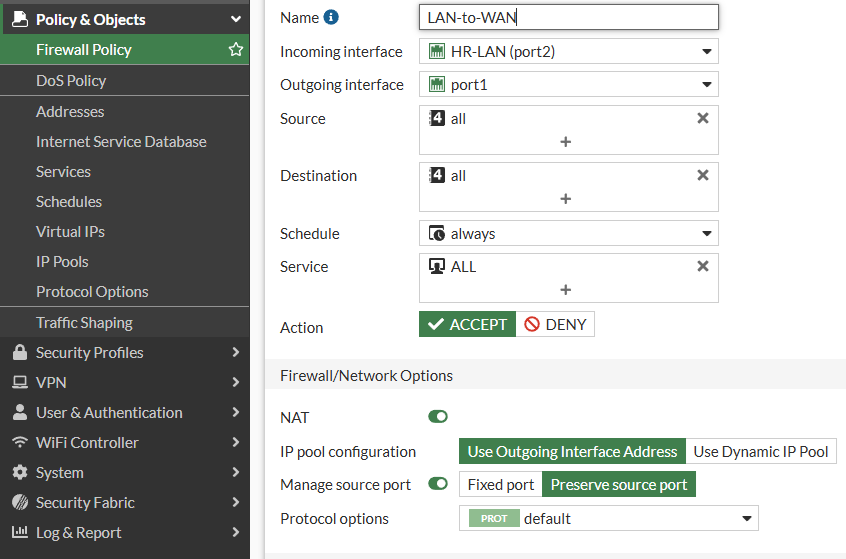

# FortiGate Network Security Lab

A hands-on network security lab built using **FortiGate 7.2.4, Cisco IOSvL2, and EVE-NG**.

## 1. Project Overview

This project demonstrates the deployment and configuration of a FortiGate firewall in a virtual enterprise network environment.

The lab covers firewall policies, outbound NAT, DHCP, DNS, WAN/LAN connectivity, switch configuration, and traffic logging.

## 2. Lab Topology

**Lab Components:**
- FortiGate 7.2.4 Firewall
- Cisco IOSvL2 Virtual Switch
- PC-HR
- PC-IT
- DMZ-Zone
- EVE-NG

## 3. IP Addressing

| Component | Configuration |
|---|---|
| WAN Interface | DHCP – 192.168.80.129/24 |
| LAN Gateway | 192.168.10.1/24 |
| DHCP Pool | 192.168.10.100–192.168.10.200 |
| LAN Interface | FortiGate port2 |

## 4. Implemented Features

- FortiGate WAN/LAN interface configuration
- DHCP server and DNS configuration
- Outbound NAT (Source NAT)
- LAN-to-WAN firewall policy
- Cisco IOSvL2 switch port configuration
- Firewall traffic logging configuration
- Network connectivity and DNS resolution testing

## 5. Configuration Evidence

### 5.1 FortiGate Firewall Policy – CLI

### 5.2 DHCP Configuration and Address Assignment

### 5.3 Internet Connectivity Test

### 5.4 Cisco IOSvL2 Switch VLAN Configuration

### 5.5 FortiGate Network Interfaces – GUI

### 5.6 FortiGate Firewall Policy – GUI

## 6. Verification Results

| Test | Result |
|---|---|
| DHCP Address Assignment | Successful |
| Default Gateway Connectivity | Successful |
| Internet Connectivity (8.8.8.8) | Successful |
| DNS Resolution (google.com) | Successful |
| LAN-to-WAN Firewall Policy | Configured |
| Source NAT | Enabled |
| Traffic Logging | Enabled in firewall policy |

## 7. Network Design Note

All three endpoints currently operate within the same LAN subnet and VLAN 10.

Separate HR, IT, and DMZ security zones and inter-VLAN isolation are not implemented in this version of the lab.

## 8. Technologies

FortiGate 7.2.4 | EVE-NG | Cisco IOSvL2 | VPCS | DHCP | DNS | NAT | Firewall Policies | ICMP

## Author

**Burak Kılıç**

Network & Security Engineering Portfolio Project
